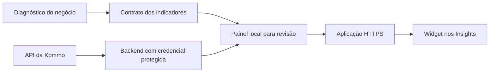

# Kommo BI — skill para Codex e Claude Code

Uma skill da **Comunidade Kommo Brasil** para construir um BI personalizado dentro dos Insights da Kommo, começando pelas perguntas certas sobre o negócio.

O agente conduz o diagnóstico, identifica os dados disponíveis, define indicadores com fórmulas claras e implementa uma aplicação web integrada à API da Kommo. O painel é incorporado por uma URL HTTPS na opção **Adicionar novo widget** dos Insights.

## Instalar

Requisitos: Git, Python 3.9+ e Codex ou Claude Code instalado. O instalador apenas copia a skill para o computador; não acessa sua Kommo, não instala dependências e não publica um site.

```bash
git clone https://github.com/LUIZOTAVIOENGENHARIADIGITAL/kommo-bi-skill.git
cd kommo-bi-skill
```

Escolha **um** comando:

```bash
# Codex
python3 install.py --agent codex

# Claude Code
python3 install.py --agent claude

# Os dois
python3 install.py --agent both
```

No Windows, use `py -3` no lugar de `python3`. Também é possível baixar **Code → Download ZIP**, extrair e executar o instalador nessa pasta, sem Git.

Abra uma nova sessão do agente depois da instalação.

| Agente | Ativação | Pasta pessoal padrão |
|---|---|---|
| Codex | `$kommo-bi` | `~/.agents/skills/kommo-bi/` |
| Claude Code | `/kommo-bi` | `~/.claude/skills/kommo-bi/` |

Para versões do Codex que usam `~/.codex/skills`, execute `python3 install.py --agent codex --codex-legacy`. Escolha o caminho reconhecido pela sua versão; evite instalar a mesma skill nos dois caminhos.

Os caminhos atuais seguem a documentação de [instalação de skills para agentes da OpenAI](https://developers.openai.com/api/reference/cli) e de [skills no Claude Code](https://code.claude.com/docs/en/skills). Esta instalação é para agentes locais, como o terminal; não instala automaticamente em ChatGPT, Cowork ou sessões hospedadas.

### Instalar pedindo ao próprio agente

Cole no Codex ou Claude Code com acesso ao terminal:

```text
Instale a skill kommo-bi deste repositório público:
https://github.com/LUIZOTAVIOENGENHARIADIGITAL/kommo-bi-skill

Leia o README e o install.py. Use a opção correspondente ao agente que estou
usando. Preserve qualquer versão existente; se houver conflito, explique
como atualizar com backup. Depois me diga como ativar a skill.
```

### Instalação manual ou por projeto

Sem executar scripts, copie a pasta inteira `skills/kommo-bi` para a pasta de skills do seu agente, incluindo `references/`.

Para limitar a skill a um projeto existente:

```bash
python3 install.py --agent both --scope project --project-dir /caminho/do/projeto
```

Use `--dry-run` para ver os destinos antes de copiar. Não é necessário instalar em todos os escopos.

## Começar seu BI

No Codex:

```text
$kommo-bi Quero um BI para minha empresa dentro dos Insights da Kommo.
Comece pelo diagnóstico: me faça as perguntas necessárias em rodadas curtas,
entenda meu processo comercial e proponha os indicadores mais úteis.
Quero revisar primeiro no localhost.
```

No Claude Code, use o mesmo pedido começando com `/kommo-bi`.

Você pode começar sem saber quais indicadores quer. A skill ajuda a definir:

- **Objetivo:** quais decisões precisam melhorar e quem usa o painel.
- **Processo comercial:** funis, etapas, venda, perda, prospecção e passagem entre funis.
- **Valores:** venda total, comissão, receita recorrente ou recebimento, conforme o negócio.
- **Aquisição:** canais, origens, UTMs e campanhas; investimento quando houver fonte disponível.
- **IA e agenda:** atendimento, autoria do agendamento, comparecimento e reagendamento.
- **Dimensões:** produtos, regiões, unidades, equipes ou, em imóveis, empreendimentos e construtoras.
- **Gestão:** metas, períodos, filtros, permissões, atualização e identidade visual.
- **Qualidade:** quais dados existem, quais estão incompletos e quais precisam começar a ser registrados.

A conversa ocorre em rodadas curtas e aproveita informações já fornecidas. Quando a API está conectada, o agente consulta a estrutura da conta em vez de pedir uma transcrição de todos os campos.

## O que será construído



Cada indicador deve ter fórmula, população, data, fonte e limitações. O painel distingue resultado do período, estoque atual e coorte de entrada. Uma tag IA não é tratada automaticamente como agendamento feito pela IA; ganho em prospecção não é somado como venda.

Hospedagem pode ser Cloudflare ou a infraestrutura adequada ao seu projeto. API, hospedagem e permissões precisam estar disponíveis para concluir a integração. A skill é um conjunto de instruções para o agente construir a solução, não um dashboard pronto nem uma assinatura de serviço. Os custos do agente e da infraestrutura dependem das contas escolhidas.

Para dados reais, a aplicação precisa de autenticação e autorização apropriadas. Credenciais ficam no backend. O agente deve orientar a configuração local de secrets, sem colocar tokens no GitHub ou no navegador. Uma demo pública deve usar somente dados fictícios identificados.

Eventos Meta podem ser demonstrados como prévias, sem enviar nada. Histórico ausente não é inventado; CPL, CAC e ROAS dependem de fontes e regras de cálculo suficientes.

## Atualizar

Na pasta clonada:

```bash
git pull --ff-only
python3 install.py --agent both --update
```

Troque `both` pelo agente que instalou e repita as opções de escopo/caminho usadas na primeira instalação. O instalador guarda a versão anterior em `skill-backups/`, ao lado de `skills/`, e imprime o caminho. Arquivos personalizados ficam no backup; não são mesclados automaticamente. Sem `--update`, uma instalação diferente é preservada e a operação para.

## Conteúdo e validação

- [SKILL.md](skills/kommo-bi/SKILL.md): fluxo de trabalho do agente.
- [Diagnóstico e briefing](skills/kommo-bi/references/briefing.md): perguntas adaptativas e contrato dos indicadores.
- [Métricas](skills/kommo-bi/references/metrics.md): fórmulas e critérios.
- [Arquitetura](skills/kommo-bi/references/architecture.md): API, iframe e hospedagem.
- [Demonstração](skills/kommo-bi/references/demo.md): exemplo imobiliário com dados fictícios.

Para testar o instalador em pastas temporárias, sem acessar sua Kommo:

```bash
python3 -m unittest discover -s tests -v
```

O formato da skill e o instalador foram verificados localmente. A qualidade de cada BI depende do diagnóstico, dos dados e da validação na conta de destino. Confira fórmulas contra a API e teste a persistência do widget antes de considerar a implantação concluída.

Criado por Luiz Otávio para a Comunidade Kommo Brasil. Projeto independente, sem vínculo oficial com Kommo, OpenAI ou Anthropic.
